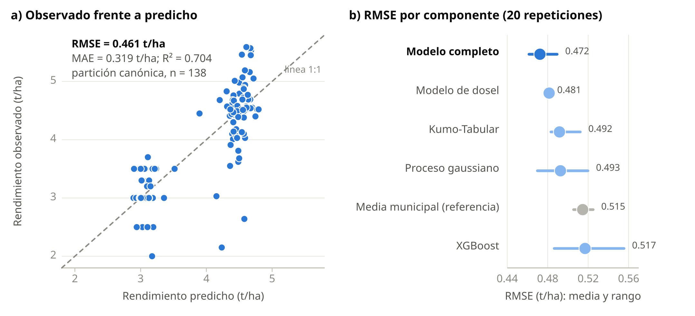
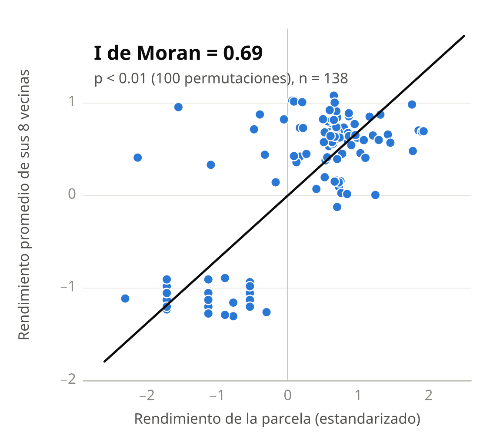
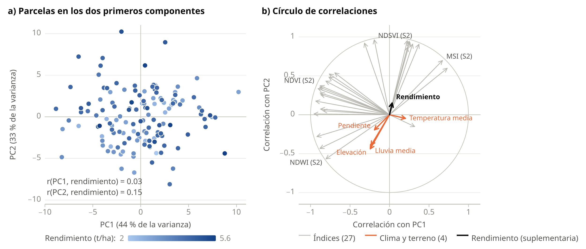
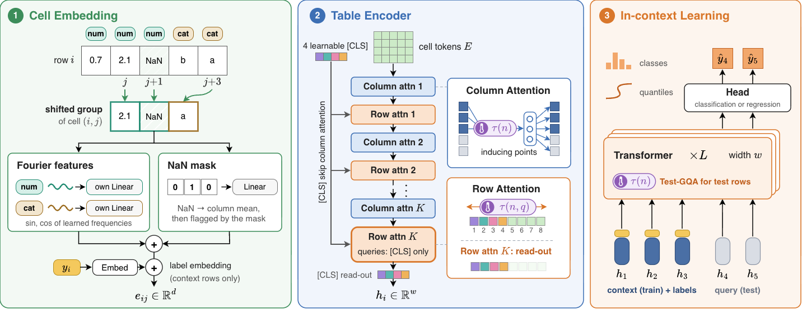
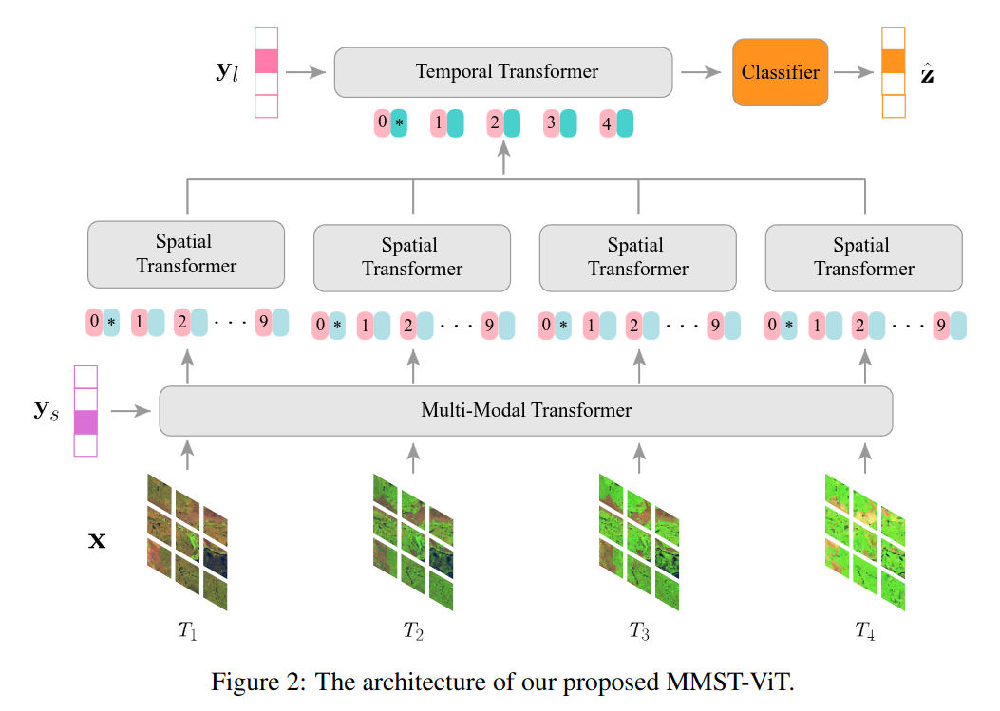

# Milli · modelo de rendimiento de cebada

Modelo del reto **AgroCebada FIRA 2026**. Estima cuántas toneladas por hectárea de cebada dio cada una de las 59 parcelas por predecir (Hidalgo, Puebla y Tlaxcala, abril–octubre de 2025). Ya viene entrenado: solo hay que correrlo.



*Figura 1. Izquierda: rendimiento real contra el predicho. Derecha: error (RMSE) de cada parte del modelo.*

## Cómo funciona

Junta cuatro modelos:

- **GP**: usa la ubicación, porque las parcelas cercanas rinden parecido (Figura 2).
- **Kumo**: modelo de NVIDIA para tablas (NVIDIA, 2026; Figura 4).
- **Dosel**: lee imágenes de satélite de Sentinel-2 con MMST-ViT y Daily DeepCropNet (Lin et al., 2023; Xiong et al., 2024; Figura 5).
- **XGBoost**: aprende del rendimiento histórico de cada municipio y del clima.

Las imágenes de satélite solas explican poco (Figura 3); la ubicación explica mucho más.

Error promedio: **0.47 t/ha** (R² = 0.69).



*Figura 2. I de Moran (Moran, 1950): las parcelas vecinas tienen rendimientos parecidos.*



*Figura 3. Análisis de componentes principales (Jolliffe y Cadima, 2016): las variables satelitales casi no siguen al rendimiento.*



*Figura 4. Cómo funciona Kumo. Tomada de Qu et al. (2026).*



*Figura 5. Cómo funciona MMST-ViT, la base del modelo de dosel. Tomada de Lin et al. (2023).*

## Cómo usarlo

```sh
pip install -r requirements.txt
python predecir.py --reto carpeta/DATASET_RETO_AGRO_2026
```

Sale un archivo `predicciones.csv` con las 59 predicciones. Funciona con o sin GPU.

## Qué datos necesitas

Solo el **dataset del reto**, que FIRA da a los equipos (Fideicomisos Instituidos en Relación con la Agricultura, 2026). Los demás datos ya vienen procesados en este repositorio:

- Imágenes Sentinel-2 (Copernicus Sentinel-2, 2021).
- Clima AgERA5 (Copernicus Climate Change Service, 2020).
- Lluvia CHIRPS (Funk et al., 2015).
- Rendimientos municipales del SIAP (Zepeda Villarreal et al., 2026).
- AlphaEarth, de Google (Brown et al., 2025).
- Kumo, de NVIDIA (NVIDIA, 2026).

## Créditos

- **Desarrollo**: [dotrdp](https://github.com/dotrdp).
- **Datos del reto**: FIRA.
- **Figuras 4 y 5**: NVIDIA (Qu et al., 2026) y Lin et al. (2023).
- **Licencias**: Kumo, de NVIDIA (OpenMDW-1.1 y Apache-2.0).

## Referencias

1. Brown, C. F., Kazmierski, M. R., Pasquarella, V. J., et al. (2025). *AlphaEarth Foundations: An embedding field model for accurate and efficient global mapping from sparse label data* (arXiv:2507.22291). arXiv. https://doi.org/10.48550/arXiv.2507.22291
2. Copernicus Climate Change Service. (2020). *Agrometeorological indicators from 1979 to present derived from reanalysis* [Conjunto de datos]. Climate Data Store. https://doi.org/10.24381/cds.6c68c9bb
3. Copernicus Sentinel-2 (procesado por la ESA). (2021). *MSI Level-2A BOA reflectance product. Collection 1* [Conjunto de datos]. Agencia Espacial Europea. https://doi.org/10.5270/S2_-znk9xsj
4. Fideicomisos Instituidos en Relación con la Agricultura. (2026). *Reto AgroCebada FIRA 2026: Bases de participación*. https://www.fira.gob.mx/Nd/Reto%20Agrocebada%20Bases.pdf
5. Funk, C., Peterson, P., Landsfeld, M., et al. (2015). The climate hazards infrared precipitation with stations—a new environmental record for monitoring extremes. *Scientific Data, 2*, 150066. https://doi.org/10.1038/sdata.2015.66
6. Jolliffe, I. T., y Cadima, J. (2016). Principal component analysis: A review and recent developments. *Philosophical Transactions of the Royal Society A, 374*(2065), 20150202. https://doi.org/10.1098/rsta.2015.0202
7. Lin, F., Crawford, S., Guillot, K., et al. (2023). MMST-ViT: Climate change-aware crop yield prediction via multi-modal spatial-temporal vision transformer. En *2023 IEEE/CVF International Conference on Computer Vision (ICCV)* (pp. 5751–5761). IEEE. https://doi.org/10.1109/ICCV51070.2023.00531
8. Moran, P. A. P. (1950). Notes on continuous stochastic phenomena. *Biometrika, 37*(1/2), 17–23. https://doi.org/10.2307/2332142
9. NVIDIA. (2026). *Kumo-Tabular* [Modelo preentrenado]. Hugging Face. https://huggingface.co/nvidia/Kumo-Tabular
10. Qu, J., Hudovernik, V., Jurkovic, M., et al. (29 de septiembre de 2026). *NVIDIA Kumo Tabular sets a new accuracy-efficiency frontier for tabular prediction*. Blog de Hugging Face. https://huggingface.co/blog/nvidia/kumo-tabular
11. Xiong, X., Zhong, R., Tian, Q., et al. (2024). Daily DeepCropNet: A hierarchical deep learning approach with daily time series of vegetation indices and climatic variables for corn yield estimation. *ISPRS Journal of Photogrammetry and Remote Sensing, 209*, 249–264. https://doi.org/10.1016/j.isprsjprs.2024.02.008
12. Zepeda Villarreal, E. A., Lopez-Ridaura, S., y Sonder, K. (2026). *Municipal Agricultural Production Database (Mexico, 2003–2024): SIACON–SIAP Harmonized Dataset with Agrobiodiversity Indicators* (Versión 3) [Conjunto de datos]. figshare. https://doi.org/10.6084/m9.figshare.32065674.v3
